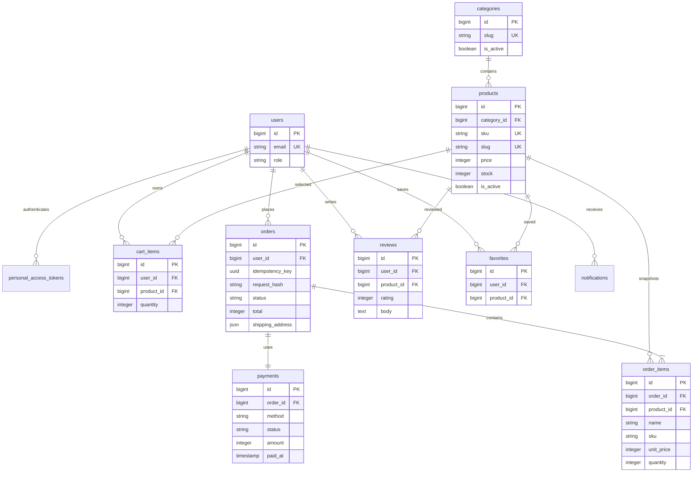

# Market API architecture

## Scope

A single-store JSON API with Admin and Customer roles, categories, products,
cart, checkout, orders, cash on delivery, deterministic mock payments, verified
purchase reviews and favorites. No external payment services. API prefix: `/api/v1`.

## Boundaries

`FormRequest -> Controller -> Service -> Repository interface -> Eloquent`

Controllers adapt HTTP and resources. Services own business rules and transaction
boundaries. Repositories own queries and persistence. Models only declare casts
and relationships. Policies enforce ownership; Gates protect administration.
Enums represent roles, order states, payment methods and payment states.

## Invariants

- Money is integer cents in USD. Prices and totals are calculated on the server.
- Checkout locks the customer's row, cart and products in ascending product ID
  order. A unique `(user_id, idempotency_key)` makes retries safe. Reusing a key
  with a different payload fails. Order lines snapshot name, SKU and price.
- All cart writes also lock the customer row. Stock is reserved at checkout;
  cancellation restores it exactly once. Mock failure leaves a retryable unpaid
  order. COD is settled only on delivery by an administrator.
- Only paid mock orders or COD orders may ship. Allowed states:
  pending -> processing -> shipped -> delivered; pending/processing -> cancelled.
- Customers may cancel only pending orders and review only delivered purchases.
- Products and categories are deactivated instead of deleted, preserving history.
- Registration always assigns Customer. Tokens expire; login and API are throttled.
- Order events dispatch after commit. A listener dispatches a queued notification
  job with a deterministic database notification ID to make retries idempotent.

## Database schema / ER diagram

Unique constraints: cart_items(user_id, product_id), favorites(user_id, product_id),
reviews(user_id, product_id), orders(user_id, idempotency_key), payments(order_id).
Foreign keys restrict deletion of historical products/orders. Framework tables
support sessions, failed jobs, batch jobs and notifications. Pagination is bounded
at 100 items; related data is eagerly loaded at repository boundaries.

## Deliberate tradeoffs

One currency, no tax/shipping calculator, no refunds or real payment gateways.
Cancellation is unavailable after shipment. Paid mock cancellations mark the
simulation refunded. A production outbox would be needed for guaranteed event
delivery across a database commit/queue outage; after-commit dispatch alone is
not a transactional outbox. Local demo credentials are supplied only via `.env`.
